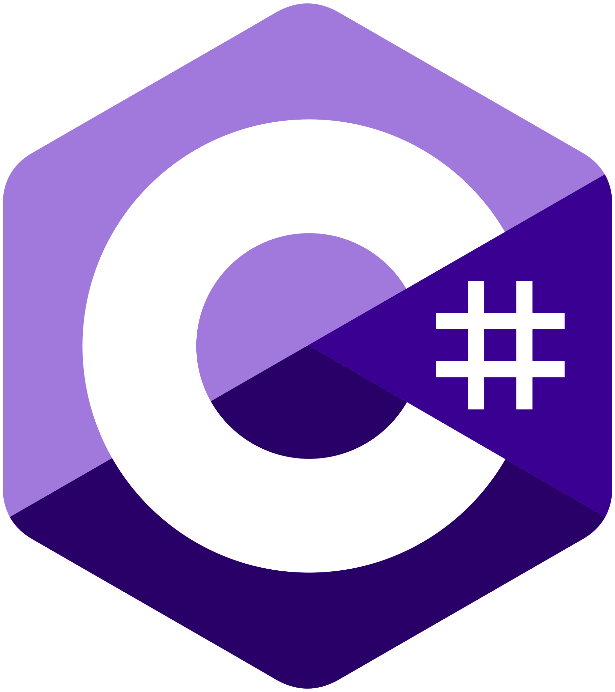
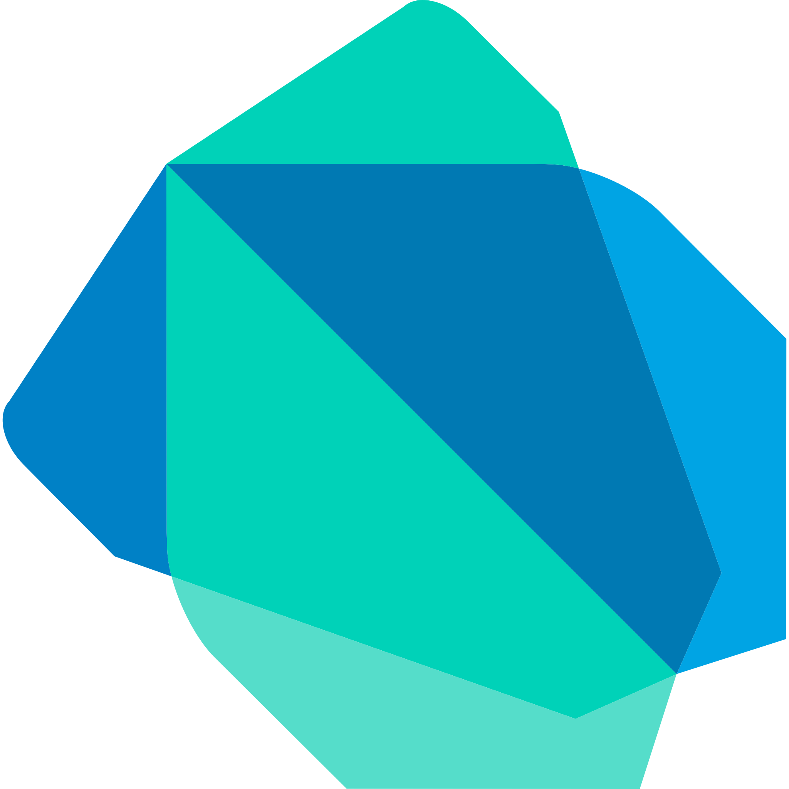
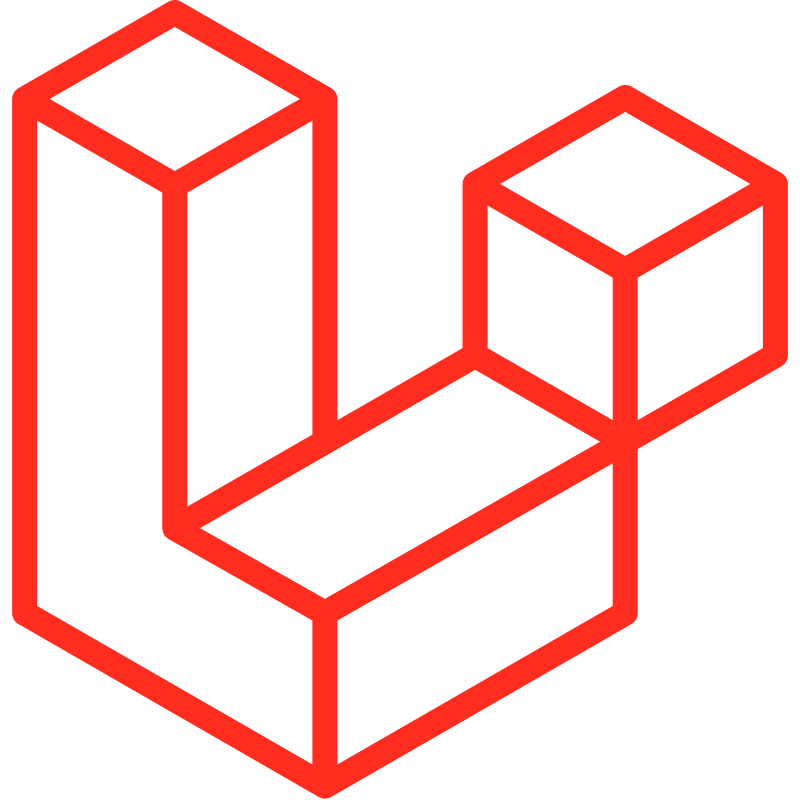

[](https://git.io/typing-svg)

[](https://www.linkedin.com/in/thinhle19/)
[](https://www.upwork.com/freelancers/~01f12733a7302716a2)
[](https://www.facebook.com/ltthinh19/)


<p align="center">
  <b>I'm a musicalholic geek</b>
</p>


<br>

- ♍ I love the process of creating things from my 10 fingers and watch them create benefits.
- 📓 I'm a student of [VNU HCMC FPT University](https://hcmuni.fpt.edu.vn).
- 🌱 I’m currently focusing on **Backend Development**.
- Show ❤ by giving ⭐ to my Repositories, at least your star could make someone's day 😄.

<!-- Tech stack -->
<h2>Tech stack 🔭</h2>
<p align="center">
  <b>Languages</b>
  <br>
  <br>
  <a href="https://en.wikipedia.org/wiki/C_(programming_language)" target="_blank">
    <code></code>
  </a>
  <a href="https://www.java.com" target="_blank">
    <code></code>
  </a>
  <a href="https://docs.microsoft.com/en-us/dotnet/csharp/" target="_blank">
    <code></code>
  </a>
  <a href="https://dart.dev/" target="_blank">
    <code></code>
  </a>
  <a href="https://developer.mozilla.org/en-US/docs/Web/JavaScript" target="_blank">
    <code></code>
  </a>
  <a href="https://www.python.org/" target="_blank">
    <code></code>
  </a>
</p>

<br>
<br>

<p align="center">
  <b>Backend</b>
  <br>
  <br>
  <a href="https://spring.io/" target="_blank">
    <code></code>
  </a> 
  <a href="https://dotnet.microsoft.com/en-us/" target="_blank">
    <code></code>
  </a> 
  <a href="https://laravel.com/" target="_blank">
    <code></code>
  </a> 
</p>

<br>
<br>

<p align="center">
  <b>Databases</b>
  <br>
  <br>
  <a href="https://www.wikiwand.com/en/Microsoft_SQL_Server" target="_blank">
    <code></code>
  </a>
  <a href="https://www.mysql.com/" target="_blank">
    <code></code>
  </a>
  <a href="https://firebase.google.com/" target="_blank">
    <code></code>
  </a>
</p>

<br>
<br>

<p align="center">
  <b>DevOps</b>
  <br>
  <br>
  <a href="https://www.docker.com/" target="_blank">
    <code></code>
  </a>
  <a href="https://nginx.org/en/" target="_blank">
    <code></code>
  </a>
  <a href="https://aws.amazon.com/" target="_blank">
    <code></code>
  </a>
  <a href="https://azure.microsoft.com/en-gb/" target="_blank">
    <code></code>
  </a>
  <a href="https://kubernetes.io/" target="_blank">
    <code></code>
  </a>
  <a href="https://sonarcloud.io/login" target="_blank">
    <code></code>
  </a>
</p>

<br>
<br>

<p align="center">
  <b>Frontend</b>
  <br>
  <br>
  <a href="https://developer.mozilla.org/en-US/docs/Web/HTML" target="_blank">
    <code></code>
  </a>
  <a href="https://developer.mozilla.org/en-US/docs/Web/CSS" target="_blank">
    <code></code>
  </a>
  <a href="https://react.dev/" target="_blank">
    <code></code>
  </a>
  <a href="https://mui.com/material-ui/" target="_blank">
    <code></code>
  </a>
  <a href="https://flutter.dev/" target="_blank">
    <code></code>
  </a>
  <br>
</p>

<br>
<br>
<!-- My activity -->
<h2>My activity </h2>
<p align="center">
  

</p>
<p align="center">
  <b>📊 Wakatime Stats</b>

  <!--START_SECTION:waka-->


**I'm a Night 🦉** 

```text
🌞 Morning                2495 commits        ⣿⣿⣿⣀⣀⣀⣀⣀⣀⣀⣀⣀⣀⣀⣀⣀⣀⣀⣀⣀⣀⣀⣀⣀⣀   11.45 % 
🌆 Daytime                5888 commits        ⣿⣿⣿⣿⣿⣿⣿⣀⣀⣀⣀⣀⣀⣀⣀⣀⣀⣀⣀⣀⣀⣀⣀⣀⣀   27.01 % 
🌃 Evening                8235 commits        ⣿⣿⣿⣿⣿⣿⣿⣿⣿⣀⣀⣀⣀⣀⣀⣀⣀⣀⣀⣀⣀⣀⣀⣀⣀   37.78 % 
🌙 Night                  5180 commits        ⣿⣿⣿⣿⣿⣿⣀⣀⣀⣀⣀⣀⣀⣀⣀⣀⣀⣀⣀⣀⣀⣀⣀⣀⣀   23.76 % 
```
📅 **I'm Most Productive on Sunday** 

```text
Monday                   3888 commits        ⣿⣿⣿⣿⣀⣀⣀⣀⣀⣀⣀⣀⣀⣀⣀⣀⣀⣀⣀⣀⣀⣀⣀⣀⣀   17.84 % 
Tuesday                  4367 commits        ⣿⣿⣿⣿⣿⣀⣀⣀⣀⣀⣀⣀⣀⣀⣀⣀⣀⣀⣀⣀⣀⣀⣀⣀⣀   20.03 % 
Wednesday                2018 commits        ⣿⣿⣀⣀⣀⣀⣀⣀⣀⣀⣀⣀⣀⣀⣀⣀⣀⣀⣀⣀⣀⣀⣀⣀⣀   09.26 % 
Thursday                 1750 commits        ⣿⣿⣀⣀⣀⣀⣀⣀⣀⣀⣀⣀⣀⣀⣀⣀⣀⣀⣀⣀⣀⣀⣀⣀⣀   08.03 % 
Friday                   2066 commits        ⣿⣿⣀⣀⣀⣀⣀⣀⣀⣀⣀⣀⣀⣀⣀⣀⣀⣀⣀⣀⣀⣀⣀⣀⣀   09.48 % 
Saturday                 2361 commits        ⣿⣿⣿⣀⣀⣀⣀⣀⣀⣀⣀⣀⣀⣀⣀⣀⣀⣀⣀⣀⣀⣀⣀⣀⣀   10.83 % 
Sunday                   5348 commits        ⣿⣿⣿⣿⣿⣿⣀⣀⣀⣀⣀⣀⣀⣀⣀⣀⣀⣀⣀⣀⣀⣀⣀⣀⣀   24.53 % 
```


📊 **This Week I Spent My Time On** 

```text
🕑︎ Time Zone: Asia/Ho_Chi_Minh

💬 Programming Languages: 
Markdown                 8 hrs 12 mins       ⣿⣿⣿⣿⣿⣿⣿⣿⣿⣿⣿⣿⣀⣀⣀⣀⣀⣀⣀⣀⣀⣀⣀⣀⣀   47.29 % 
TypeScript               3 hrs 36 mins       ⣿⣿⣿⣿⣿⣀⣀⣀⣀⣀⣀⣀⣀⣀⣀⣀⣀⣀⣀⣀⣀⣀⣀⣀⣀   20.78 % 
Bash                     1 hr 15 mins        ⣿⣿⣀⣀⣀⣀⣀⣀⣀⣀⣀⣀⣀⣀⣀⣀⣀⣀⣀⣀⣀⣀⣀⣀⣀   07.29 % 
C#                       1 hr 13 mins        ⣿⣿⣀⣀⣀⣀⣀⣀⣀⣀⣀⣀⣀⣀⣀⣀⣀⣀⣀⣀⣀⣀⣀⣀⣀   07.07 % 
YAML                     50 mins             ⣿⣀⣀⣀⣀⣀⣀⣀⣀⣀⣀⣀⣀⣀⣀⣀⣀⣀⣀⣀⣀⣀⣀⣀⣀   04.86 % 

🔥 Editors: 
Codex Vscode             10 hrs 53 mins      ⣿⣿⣿⣿⣿⣿⣿⣿⣿⣿⣿⣿⣿⣿⣿⣿⣀⣀⣀⣀⣀⣀⣀⣀⣀   62.73 % 
VS Code                  5 hrs 58 mins       ⣿⣿⣿⣿⣿⣿⣿⣿⣿⣀⣀⣀⣀⣀⣀⣀⣀⣀⣀⣀⣀⣀⣀⣀⣀   34.43 % 
Codex CLI                29 mins             ⣿⣀⣀⣀⣀⣀⣀⣀⣀⣀⣀⣀⣀⣀⣀⣀⣀⣀⣀⣀⣀⣀⣀⣀⣀   02.84 % 
```

🤖 **AI Coding This Week** 

```text
⏱ AI Coding Time: 14 hrs 17 mins (82.29%)

✍️ 7,059 lines written by AI, 236 lines written by hand (96.76% AI-written)

🔤 6,667,722 Input Tokens, 819,939 Output Tokens

💵 $56.28 Estimated AI Cost This Week

🧠 91 AI Sessions, 248 AI Prompts

GPT                      7,071 lines         ⣿⣿⣿⣿⣿⣿⣿⣿⣿⣿⣿⣿⣿⣿⣿⣿⣿⣿⣿⣿⣿⣿⣿⣿⣿   99.99 % 
K                        1 lines             ⣀⣀⣀⣀⣀⣀⣀⣀⣀⣀⣀⣀⣀⣀⣀⣀⣀⣀⣀⣀⣀⣀⣀⣀⣀   00.01 % 
Codex-Vscode             0 lines             ⣀⣀⣀⣀⣀⣀⣀⣀⣀⣀⣀⣀⣀⣀⣀⣀⣀⣀⣀⣀⣀⣀⣀⣀⣀   00.00 % 
Codex-Cli                0 lines             ⣀⣀⣀⣀⣀⣀⣀⣀⣀⣀⣀⣀⣀⣀⣀⣀⣀⣀⣀⣀⣀⣀⣀⣀⣀   00.00 % 
Opencode-Cli             0 lines             ⣀⣀⣀⣀⣀⣀⣀⣀⣀⣀⣀⣀⣀⣀⣀⣀⣀⣀⣀⣀⣀⣀⣀⣀⣀   00.00 % 

🔎 AI Coding Insights:
🤖 AI-Driven — 96.76% of written lines came from AI
📄 Detailed Prompter — average 889 characters per prompt
🔁 Iterative Prompter — average 3 prompts per session
🚀 High AI Trust — 4.2% of changed lines were hand-edited
```


<!--END_SECTION:waka-->
</p>
